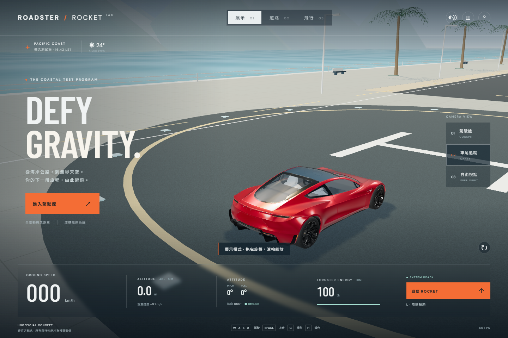

# ROADSTER / ROCKET — Concept Flight Lab

非官方 Tesla Roadster Rocket Edition 風格的 3D 展示、沿海駕駛及飛行沙盒。

**[直接試玩](https://sion-rgb.github.io/roadster-rocket-lab/)** · **[驗證報告](artifacts/final-evidence.md)** · **[車模來源與授權](ASSET_CREDITS.md)**



這是獨立概念作品，與 Tesla 沒有關聯或官方認可。車身使用公尺尺度；車輛尺寸、質量、速度、推力、能量、飛行高度及姿態控制均為本模擬器的虛構設定，不代表量產車規格或經官方證實的飛行性能。介面持續顯示模擬提示。

## 功能

- 三種模式：展示環繞、道路駕駛、Rocket 飛行；即時切換。
- 三種鏡頭：駕駛艙、車尾追蹤、遠距自由觀眾；GSAP 平滑切鏡，包含傾斜姿態。
- Rapier 動態車身、四輪射線懸掛、輪胎煞車、城市建築與海岸碰撞；固定 60 Hz、CCD。
- 起飛、懸停、升降、前進、偏航、俯仰、翻滾、飛行煞車、手動下降及自動降落輔助。
- 即時速度、高度、垂直速度、俯仰、翻滾、航向、能量與接地狀態；落地充能、低能量自動緊急下降。
- 三個停機區、硬著陸回饋、R 快速重置；越界或落海安全返回。
- 合法授權詳細 GLB/PBR 車模、獨立車輪、駕駛艙內裝、原創推進器及粒子。
- 動態陰影、環境反射、動畫海水及天空、材質地面、實例化城市與棕櫚樹。
- Web Audio 電動機與推進器音效，預設靜音，使用者按音效鍵後啟用；可暫停、關閉音效。
- 鍵盤、滑鼠、手機觸控及 Gamepad 輸入接口。支援減少動態效果偏好。

## 安裝及執行

需要 Node.js 22.12+ 或 24+、npm，以及支援 WebGL2 / WebAssembly 的現代瀏覽器。

```bash
git clone https://github.com/sion-rgb/roadster-rocket-lab.git
cd roadster-rocket-lab
npm ci
npm run dev
```

打開終端顯示的網址，預設 `http://localhost:5188/`。同一區域網絡的手機可使用終端列出的 Network URL。此專案不含帳戶、資料庫或 API 金鑰。

正式版本：

```bash
npm run build
npm run preview -- --port 5188
```

請透過 HTTP(S) 開啟，不能直接雙擊 `index.html`。GLB、Draco、WASM 需要伺服器。模型與解碼器隨專案提供；字體嘗試載入 Google Fonts，離線時使用系統字體。沒有 Service Worker 離線快取。

## 操作

| 動作 | 鍵盤 / 滑鼠 |
| --- | --- |
| 前進 / 倒車 | W / S 或方向鍵上下 |
| 道路轉向 / 飛行偏航 | A / D 或方向鍵左右 |
| 煞車，飛行時抑制水平速度 | B |
| 推進加速 | Shift |
| 切換道路 / 飛行 | F，或頂部模式按鈕 |
| 上升 / 下降 | Space / Ctrl |
| 機鼻向上 / 向下 | I / K |
| 左 / 右翻滾 | Q / E |
| 降落輔助 / 解除 | L |
| 駕駛艙 / 車尾 / 自由觀眾 | 1 / 2 / 3 |
| 循環視角 | C |
| 展示 / 觀眾環繞、駕駛艙環視 | 滑鼠或觸控拖曳 |
| 展示 / 觀眾縮放 | 滾輪 / 雙指縮放 |
| 重置 / 暫停 / 說明 | R / Esc / H |

手機在道路 / 飛行模式顯示長按方向、油門、升降、姿態、煞車及加速按鈕。放手、觸控取消及頁面失焦會清除按鍵狀態。暫停時物理停止；切回分頁需按繼續。

Gamepad 預留標準映射：左搖桿轉向、右搖桿姿態，RT / LT 油門，A / B 升降，X 煞車，LB 加速。**未以實體 Gamepad 驗證。**

手動降落：按 B 減低水平速度，放開姿態控制讓車身回正，按住 Ctrl 下降。近地有模擬緩衝，仍需維持輪胎朝下；姿態失控或接地垂直速度大於 4 m/s 會判定硬著陸。L 可制動、回正及緩慢下降，並不會自動導航到停機區；需自行對準停機區。能量落地補充，耗盡時使用虛構緊急下降控制。

## 測試

```bash
npm test
npm run build
# 首次安裝瀏覽器測試依賴
npm exec -- playwright install chromium ffmpeg
npm run preview -- --port 5188
# 另一個終端，預覽伺服器保持執行
npm run test:browser
```

`npm test` 使用真實 Rapier WASM 測試懸掛、加速、轉向、起飛、能量、姿態、飛行煞車、降落及重置。瀏覽器測試優先使用本機 Chrome，沒有 Chrome 時使用 Playwright Chromium；以真實鍵盤 / 滑鼠及 Chromium 觸控事件驗證核心流程，產生 JSON、桌面 / 手機截圖及 WebM 操作錄影。自訂測試網址：`SIM_URL` 環境變數；自訂 Chrome channel：`PW_CHANNEL`。

`?qa=1` 才會啟用診斷與截圖 hooks；一般入口不提供修改模擬狀態的測試接口。自動截圖不能取代實體手機、Gamepad、所有瀏覽器和無障礙輔助技術的裝置驗證。

## 架構及效能

`src/physics.ts` 負責物理與模擬參數；`input.ts` 統一鍵盤 / 觸控 / Gamepad 意圖；`cameras.ts` 管理視角及 GSAP 過渡；`car.ts` 載入模型；`world.ts` 建立場景；`main.ts` 統一輸入 → 固定物理 → 車模同步 → VFX / HUD / 相機 → 繪圖。

初次載入寬度 ≤760px 使用約 202k triangles 的手機車模，桌面保留約 609k；保留同一材質及紋理。實例化重複建築元素，使用簡單碰撞體；DPR 上限桌面 1.75 / 手機 1.25，單方向陰影 2048 / 1024，沒有全螢幕後製通道。手機版依然有較高幾何負擔，詳細數據與限制見驗證報告。

Vite 的 Rapier WASM 相容包約 2.24 MB（gzip 約 0.83 MB），會產生 chunk 大小提示；已分離 physics / three bundle。這是資產體積提示，並非編譯失敗。

## GitHub Pages

`.github/workflows/pages.yml` 在 main 推送後執行 `npm ci`、Rapier 測試、TypeScript / Vite build，再發佈 Pages。相對 `base: './'` 支援 repository 子路徑。其他靜態主機只需發佈 `dist/`。

## 授權

原創程式碼為 MIT。Roadster 2020 模型由 **metarex.4d** 製作，**CC BY 4.0**，手機簡化版及執行時材質 / 比例調整屬本專案修改；Draco 為 Apache 2.0。完整來源、授權核對及 SHA-256 見 [ASSET_CREDITS.md](ASSET_CREDITS.md)。Tesla / Roadster 名稱與模型中的商標屬原權利人。
