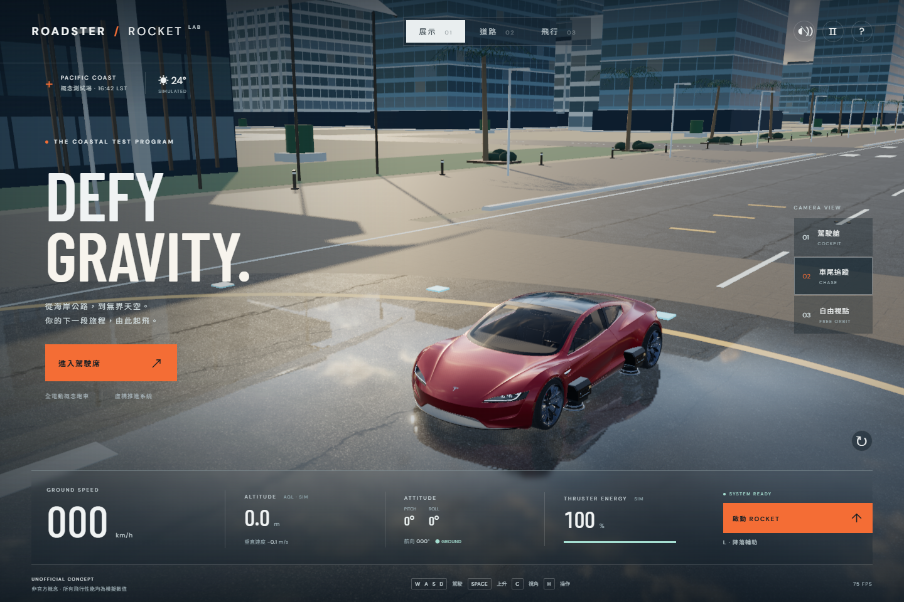

# v1.1 畫質提升及驗證

2026-10-19，非官方概念模擬器。保留原本三模式、三視角、Rapier 操作及模擬參數聲明。

已發布至 [GitHub Pages v1.1](https://sion-rgb.github.io/roadster-rocket-lab/?v=1.1.0)。應用程式碼 commit `a737b0a73493102c0d3dd16807cdf84745e037fb` 的 [Actions測試 / 建置 / 部署](https://github.com/sion-rgb/roadster-rocket-lab/actions/runs/39223069381)成功。部署後以Chrome確認新版HDR / PBR及反射載入、W駕駛、起飛、三視角及輔助降落，9項線上檢查通過，JS / HTTP / WebGL錯誤為0。[公開站點記錄](public-live.json) / [截圖](public-live.png)。

## 這次實際改動

| 部分 | v1.0 基線 | v1.1 |
| --- | --- | --- |
| 光照 | 與海岸不一致的室內環境光 | Poly Haven 2k 戶外 HDR 天空及照明，主光方向依天空亮區調整，降低過強補光 |
| 車漆 | 來源 specularIntensity=0、亮斑及顏色層次不理想 | 恢復 dielectric 高光，調整紅色漆、清漆、微表面及金屬比例 |
| 車身反射 | 靜態室內環境 | 128px 動態六面 cubemap，約每0.38秒捕捉周圍城市 / 天空；11種車身材質使用本地反射 |
| 玻璃 / 內裝 | 白灰座椅、玻璃透明層疊及高光不一致 | 深色單面玻璃保留駕駛艙視野，座椅改成非金屬皮革，輪圈 / 碳纖維保留原始細節貼圖 |
| 地面 | 程序噪點 | CC0 照片級 asphalt / concrete 的 albedo、OpenGL normal、roughness，公尺尺度 UV |
| 海面及停機坪 | 解析天空顏色 | 有實際場景內容的平面反射，海面 Fresnel / 波紋 / 岸線泡沫；濕潤停機坪可映出車體及建築 |
| 陰影 | 簡單車體代理 | 桌面主車殼及輪胎實際投影、PCF 柔化及隨高度減弱的接地陰影；手機保留低成本代理 |
| 推進器 | 簡單外殼及方形粒子 | 六種材質合批的噴嘴、陶瓷喉管、金屬環、固定支架、冷卻槽；漸淡錐形噴流及圓形柔光粒子 |
| 世界模型 | 較單一的平地 / 尖錐遠山 | 曲面航站樓雨棚、立柱 / 入口百葉、排水格柵、路緣石、路釘、海岸護石、植被、PAD字樣及連續起伏山脊 |
| 展示 / 抗鋸齒 | 車尾角度、一般繪圖 | 車頭三分之四角度，手機拉遠；桌面4× MSAA HDR target、輕微Bloom、OutputPass |

原始 Roadster GLB 及手機簡化 GLB 均未改動；模型作者及 CC BY 4.0 授權保留。新增 HDR 及9張 PBR照片材質均為 CC0，來源、下載網址及 SHA-256 見 [ASSET_CREDITS](../../ASSET_CREDITS.md)。本次沒有提交付費素材生成工作。

## 對照畫面

相同的道路 / 飛行視角可比對材質和照明；展示畫面另有改善取景。畫面均來自實際 WebGL 繪圖，不是概念圖。

| 狀態 | 基線 | 新版 |
| --- | --- | --- |
| 展示 | [before](before/desktop-showcase.png) | [after](after/desktop-showcase.png) |
| 道路 | [before](before/desktop-active-driving.png) | [after](inspection/desktop-active-driving.png) |
| 飛行 | [before](before/desktop-active-flight.png) | [after](inspection/desktop-active-flight.png) |
| 駕駛艙 | [before](before/desktop-cockpit.png) | [after](inspection/desktop-cockpit.png) |
| 遠距觀眾 | [before](before/desktop-spectator.png) | [after](inspection/desktop-spectator.png) |
| 手機展示 | [before](before/mobile-showcase.png) | [after](after/mobile-showcase.png) |
| 手機飛行 | [before](before/mobile-active-flight.png) | [after](inspection/mobile-active-flight.png) |

## 實際驗證

- TypeScript / Vite production build通過。
- [12項 Rapier 物理檢查](../../tests/physics.ts)通過。
- [17項真實鍵盤 / 滑鼠 / 觸控瀏覽器檢查](../browser-report.json)重跑通過：加速、轉向、三視角、起飛、俯仰 / 翻滾、手動 / 輔助降落、音效、暫停及手機操作；JS與HTTP錯誤為0。
- [專用畫質驗證](verification.json)通過：11個HDR / PBR檔案SHA-256一致；桌面 / 手機的展示及飛行4種場景均載入授權GLB、HDR、正確反射分級；WebGL錯誤為0。
- 5個當次 canvas inspector狀態均非空、無JS / shader錯誤，capture manifest檢查通過9項必要報告與檔案。[清單](evidence.json)。
- 初次反射曾在陰影depth map未初始化時綁定錯誤的shadow sampler。已在第一個反射pass前建立真正陰影圖；修正後`gl.getError()`為0。沒有把只檢查console的結果當作GPU成功。

早期含GPU警告的 [中間版本記錄](iteration-before-shadow-init.json)明確保留作歷史；`verification.json`及`after/report.json`是修正後結果。
- [新操作錄影](../motion/desktop-playthrough.webm)包含新版實際駕駛、鏡頭及起降。

重現：先執行`npm run preview -- --port 5188`，另開終端執行`npm run test:browser`及`npm run test:graphics`。`SIM_URL`可指定其他本地 / 線上網址。`npm run test:visual -- before` / `after`會生成對照截圖；應先保留要比較的舊build再擷取before。

## 效能及取捨

同一Chrome / ANGLE / RTX2070 SUPER、DPR=1，桌面1440×960、手機模擬390×844。基線及新版主要樣本約75FPS；這是桌面GPU結果，不能代表實體手機。

| 測量 | v1.0 | v1.1 |
| --- | ---: | ---: |
| 桌面一般飛行frame draw calls | 107 | 138 |
| 桌面飛行期間平均 draw calls，含反射 / 後製 | 未量完整平均 | 約161 |
| 桌面全pass峰值 draw calls / triangles | 未量 | 669 / 5.26M |
| 桌面一般frame triangles | 1.02M | 1.27M |
| 桌面 textures | 18 | 45 |
| 手機一般frame draw calls | 107 | 116 |
| 手機飛行期間平均 draw calls | 未量完整平均 | 約116 |
| 手機全pass峰值 draw calls / triangles | 未量 | 281 / 1.54M |
| 手機一般frame triangles / textures | 556k /18 | 646k /29 |

新診斷`renderer.info.autoReset=false`，每個主frame開始重置一次，並累積cube六面、平面反射、陰影及後製。峰值包含首次暖機及多個反射同時更新。沒有只量最後的全螢幕quad來低報成本。平均draw calls仍在技能起始預算內；峰值及triangles超出預算，明確保留為畫質取捨。

桌面：2k HDR、128px車身cube約2.6Hz、512px平面反射約10Hz、2048陰影、4×MSAA及輕微Bloom。手機：1kHDR、256px海面反射約3Hz、1024陰影、約202k車模，關閉動態車身cube / 濕地平面反射 / Bloom；沒有降低原本觸控功能。

反射採定時更新，快速移動時可能略有延遲；有限解析度會使近距反射變柔。低階實體手機、Safari、Firefox及實體Gamepad尚未驗證。為了避免不必要的依賴與資產體積，沒有更換原始609k的授權車模，而是改善其材質、照明及真實幾何附件。

## 視覺檢查

依Three.js graphics skill的2 /3級校準圖，自評以這次before / after實際截圖為準，0–3分：

| 類別 | 前 | 後 | 證據 |
| --- | ---: | ---: | --- |
| Art direction | 2 | 2.7 | 戶外天空、雨後地面、冷玻璃與暖車漆形成一致場景 |
| Hero | 2.5 | 3 | 保留細節GLB，車漆 / 輪圈 / 內裝及分層噴嘴 |
| 道路 / 建築障礙 | 2 | 2.4 | 清楚的路緣、退讓車道、層次入口及固定碰撞代理 |
| 停機區互動 | 2 | 2.5 | PAD編號、燈及濕地反射，接地回饋仍正常 |
| World | 1.8 | 2.4 | 曲面雨棚、護石、連續地形及人尺度街道配件 |
| Materials | 1.8 | 2.8 | 9張真實PBR照片貼圖及保留原車法線 / UV |
| Lighting | 1.6 | 2.8 | 戶外HDR、場景反射、投影與接地陰影 |
| VFX | 1.4 | 2.4 | 錐形噴流與漸淡圓粒子，只有推進時出現 |
| UI | 2.5 | 2.5 | 保留可讀HUD / 控制，手機拉遠車體 |
| Performance evidence | 2 | 2.4 | 實際GPU、前後對照、包含反射的平均及峰值數據 |

自評平均2.59，不代表寫實AAA或所有裝置認證。城市建築與植被仍採程序化風格，沒有把它們描述為實景掃描模型。
